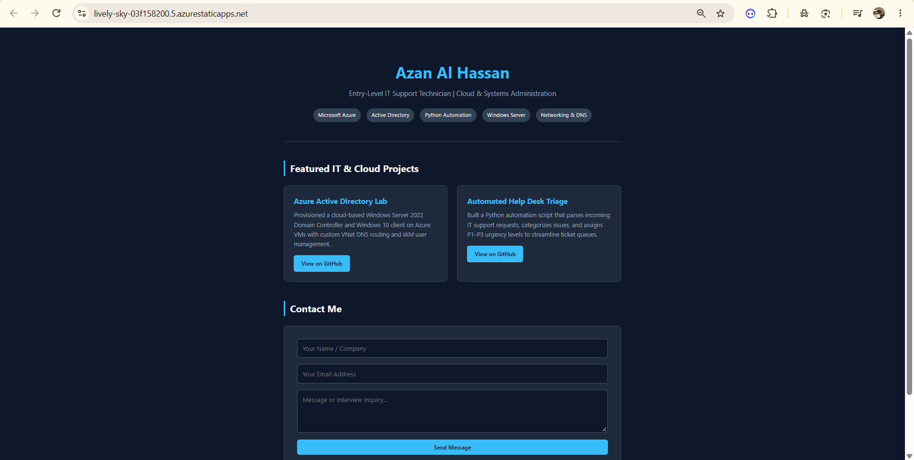
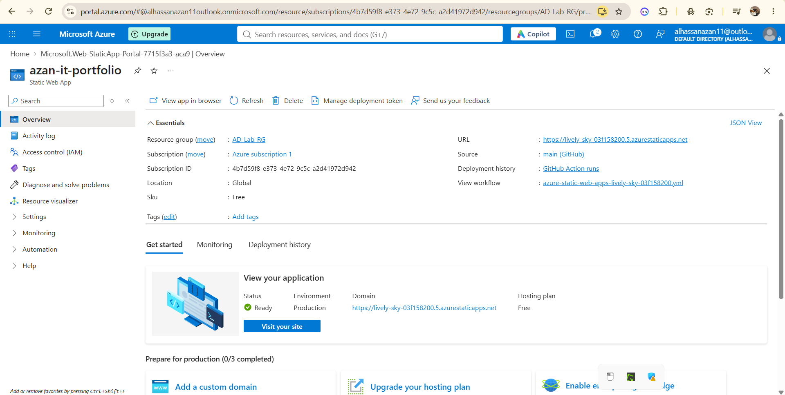

# Cloud-Hosted IT Portfolio & Serverless Contact Form

## Project Overview
Designed, built, and deployed a responsive static portfolio website hosted on **Microsoft Azure Static Web Apps** with automated CI/CD deployment via GitHub Actions and serverless form handling via Formspree.

**Live Website:** [View Portfolio](https://your-azure-url-here.azurestaticapps.net)

## Architecture & Technologies Used
* **Cloud Hosting & CI/CD:** Microsoft Azure Static Web Apps (Free Tier) integrated with GitHub Actions for automatic deployments on commit.
* **Frontend:** HTML5, CSS3 (Responsive Grid & Dark UI)
* **Serverless Backend:** Formspree REST endpoint for secure, zero-server contact form submissions.

## Deployment Visuals

### 1. Live Portfolio Website

### 2. Azure Static Web App Resource Overview

